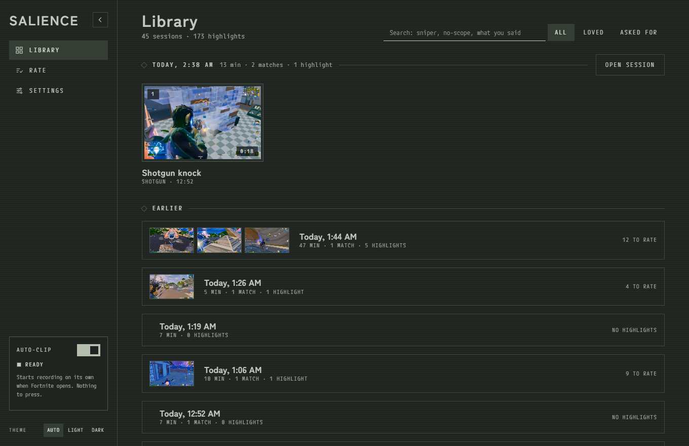
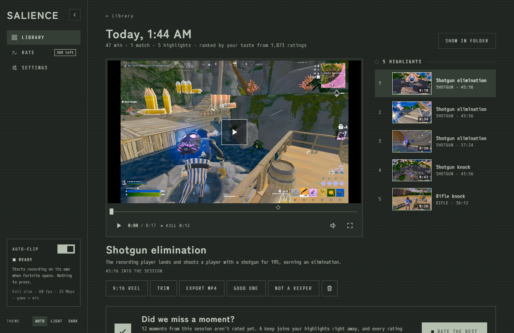
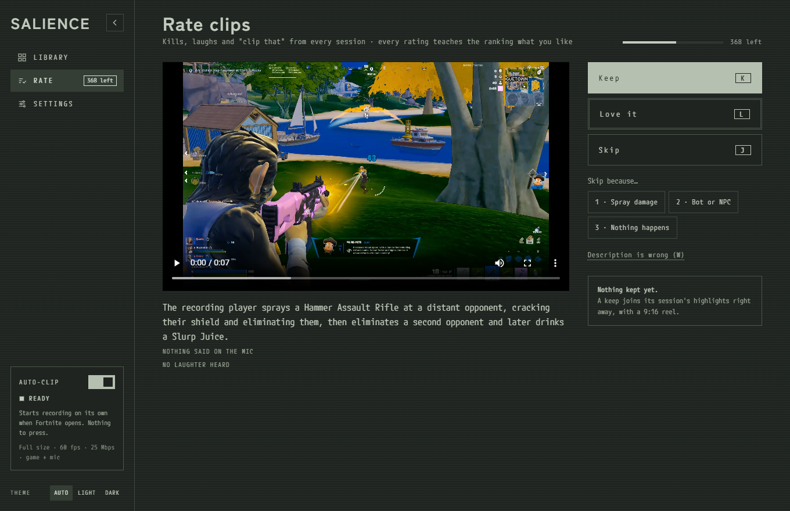

# Salience

[](https://github.com/ethanntann/salience/actions/workflows/ci.yml)
[](LICENSE)

**A Fortnite auto-clipper that keeps the clips *you* would have kept.**

Salience records your games in the background. When you close Fortnite, a
vision model describes every 8 seconds of your matches, and a model trained
on your own keep/skip ratings picks your highlights. They're ready about two
minutes later. Nothing runs during play except the recorder, nothing touches
the game process (so anti-cheat sees an ordinary screen recorder), and you
don't need OBS.



## The problem

Clipping tools either save the last 30 seconds when you press a key, which
you forget mid-fight, or guess from loud audio or button-mashing. When I
measured that second approach on my own footage, a live trigger caught only
**5 of the 15** moments I actually kept. And "good" is personal: one player
keeps clean snipes, another keeps the moment their friends lost it on
Discord. Salience looks at every moment and learns what *you* keep.

| A session's highlights, ranked by your taste | Rating teaches the ranking |
|---|---|
|  |  |

## How it works

```
during play     game window ──Windows Graphics Capture──▶ NVENC (GPU) segments
                + game audio, mic, friends (separate tracks), key presses
                                    │  Fortnite closes
after the game                      ▼
   Fortnite's own log ─▶ only the windows inside a match (lobby skipped)
   8 s windows ─▶ 7 frames + kill-banner check ─▶ vision model description
   mic & friends ─▶ local speech-to-text + laughter detection
                                    │
   your keep/skip ratings ─▶ logistic taste ranker (embeddings + speech)
                                    ▼
          highlights: every kill you'd keep, with lead-in, plus 9:16 reels
```

- **Capture** (`pipeline_v2/capture/`): FFmpeg's `gfxcapture` keeps frames on
  the GPU (about 3% of a CPU core, against 63–112% for a Python capture
  loop). Audio comes in as three WASAPI tracks.
- **Describing** (`pipeline_v2/vlm.py`, `prompt.py`): a Fortnite word bank
  tells the model which visible cue earns each term (a shield crack, a box,
  a third party) and bans describing scenery.
- **Ranking** (`pipeline_v2/ranking.py`, `taste.py`): what happened first
  (wins, kills, knocks), then a logistic ranker trained on your ratings.
  Speech counts only as much as cross-validation on *your* ratings says it
  should.
- **Desktop app** (`pipeline_v2/capture/desktop/`): a pywebview window
  (library, player, trim, 9:16 reels, rating) and a tray recorder that starts
  when Fortnite opens.

## Results

All measured out of sample on my own sessions (one player, so far):

| What | Result |
|---|---|
| Ranking with "what happened, then taste" (train on one evening, test on another) | **97.4%** of kept/skipped pairs in the right order |
| Telling the model the player's name and match phase from the game log (33 kept moments) | kept moments in the top 10: **11 → 15** |
| Leaving out kills you'd skip, held out one session at a time | shows **83%** of kept kills and drops **56%** of skipped ones (taste alone: 64% / 67%) |
| Choosing the vision model: 8 models tried on the 9 hardest windows | the chosen one matched the most accurate on 8 of 9 at **1/20 the price** (~$0.003 a window, about $0.50 per half hour of matches) |
| A new player's taste with 20 liked clips added (simulated) | **78% → 85%** with only 10 ratings |
| Use so far | 45 sessions, 173 highlights, 1,873 ratings |
| Tests | 649 Python (`python -m pytest`) + 14 for the relay (`npm test` in `relay/`), on every push (CI) |

The full measurement log, with every design decision and the experiments
behind it, is in [`docs/engineering-notes.md`](docs/engineering-notes.md).

## Key decisions

- **Nothing heavy during play.** Describing while playing cost about 11 fps
  (149 vs 160), so all analysis waits for the game to close. That rule
  extends to the UI: a once-a-second clock in the window turned out to pull
  fullscreen Fortnite out of its fast display path, freezing it every
  second. I found it with PresentMon, by spotting which process presented
  frames on a 1 s beat, and now nothing in the window redraws on a timer.
- **Look at everything, not just triggers.** Describing every in-match
  window costs cents and finds the moments a trigger misses.
- **Keep data local.** Only gameplay frames go to the vision model, through
  the player's own Fireworks key or the beta relay. Audio, transcripts,
  inputs and ratings stay on the PC.
- **No game hooks, no OBS requirement.** Capture uses the same OS APIs as
  any screen recorder. OBS users can still let Salience use their OBS
  recordings instead (Settings → Use my OBS recordings).
- **Cold start.** A new player can add clips or montages they already like
  (Settings → Clips you like). Imports count as half a rating and are
  dropped automatically if they make the player's own ratings rank worse.

## Beta: no API key, one-click install

- **Installer** (`installer/`): `python installer/build.py` makes a 205 MB
  per-user setup with its own Python, the app and FFmpeg. Testers install
  nothing else and need no admin rights.
- **Relay** (`relay/`): a Cloudflare Worker that holds the project's
  Fireworks key so testers never see it. An invite code gets each install its
  own token and 5 hours of matches a month, with a dollar cap. The relay
  keeps calls under the account's limit, shares capacity fairly between
  players, forwards only Salience's own requests (its model and fields, text
  and inline frames), and stops itself at a monthly budget. Frames pass
  through it and are never stored.
- **Export my stats** (Settings): a tester can send back counts (sessions,
  highlights kept, time to highlights, stalls during matches) and nothing
  else.

## Privacy and security

- **What leaves your PC:** only gameplay frames, about 7 per 8 seconds of a
  match, sent to the vision model through Fireworks (your own key) or the
  beta relay (Cloudflare, then Fireworks). The relay never stores or logs
  them. Audio, transcripts, key presses and ratings stay on your PC.
- **Storage:** raw footage is deleted 3 days after a session is fully rated,
  or after 7 days; lobby footage while you play; and recording stops with
  under 10 GB free. Highlights and reels are kept.
- **The app's local server** answers only its own window (a per-launch
  secret and a `Host` check), so a website you visit cannot drive it.
- The installer's Python download and every package are pinned and checked.
  See [SECURITY.md](SECURITY.md) to report a problem.

## Run it

Windows 11, Python 3.11+, FFmpeg 8+ on PATH, an NVIDIA GPU, and a
[Fireworks](https://fireworks.ai) API key.

```powershell
python -m pip install -e ".[dev,audio,app]"
.\Salience.cmd
```

The first run asks for your Fireworks key (or a beta invite code), which is
stored only on your PC in `%APPDATA%\Salience\settings.env`. Turn on **Auto-clip**, play, and close
Fortnite; the highlights open when they're ready. Recordings are about
11 GB an hour, and raw footage is deleted after 7 days by default
(`SALIENCE_KEEP_FOOTAGE_DAYS`).

## License

[MIT](LICENSE). Fortnite is a trademark of Epic Games; Salience is not
affiliated with or endorsed by Epic Games.

## Layout

```
pipeline_v2/            describing, embedding, the taste ranker, the CLI
pipeline_v2/capture/    recorder, tray app, highlights pipeline, desktop app
pipeline_v2/games/      the Fortnite word bank and log reading
salience_media/         FFmpeg helpers
relay/                  the beta's Cloudflare Worker (key, invites, limits)
installer/              builds Salience-Setup.exe
docs/                   engineering notes and screenshots
```
