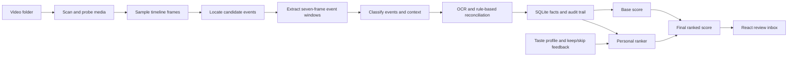
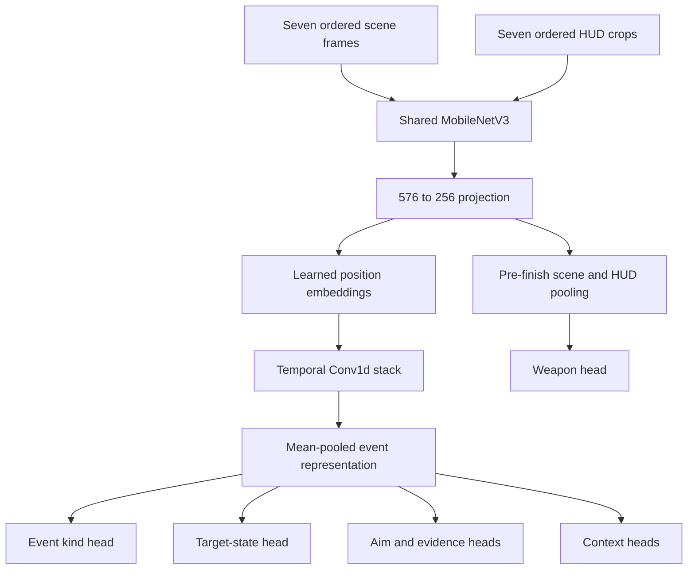

> Historical snapshot, superseded by the root README and pipeline_v2/SCOPE.md.
> Relative links below refer to the original document location.

# Learning Salience

This guide teaches the project from three angles at once:

1. what the product does;
2. how a clip moves through the code;
3. which machine-learning ideas, frameworks, and engineering choices make that possible.

You do not need to understand every file before changing the project. Start with the mental model below, run the application once, trace one clip, and then use the later sections as a reference.

## The ten-minute mental model

Salience ranks Fortnite clips. It does not record gameplay and it does not replace an existing clipper. It scans clips that another tool has already saved, extracts visual evidence, describes important events, assigns a score, and learns which types of clips a particular user likes.

The project contains **three different kinds of intelligence**:

| System | What it learns or decides | Where it runs | How it is built |
| --- | --- | --- | --- |
| Cloud teacher | Rich labels such as event time, weapon, elimination type, and context | Development time only | A prompted Qwen vision-language model through an OpenAI-compatible API |
| Local student | A compact approximation of the teacher's judgments | Shipped runtime, normally on CPU | MobileNetV3-Small models trained with PyTorch and exported to ONNX |
| Personal ranker | Which already-analyzed clips this user prefers | Locally after feedback | A small centroid/linear model rebuilt from keep/skip feedback |

The word **teacher** is slightly overloaded in the code. `FireworksTeacherClient` is the real cloud teacher. `LocalTeacherClient` adapts the local student to the same Python interface so the rest of the application can swap one for the other. The local client is still the student model even though its class name ends in `TeacherClient`.

The shortest accurate description of the architecture is:



There are two modes through the middle of this flow:

- During data creation, a cloud vision-language model locates and labels events. Its reviewed, promoted output becomes training data.
- In the shipped application, two small ONNX models perform those jobs locally. RapidOCR supplies literal HUD and end-screen text that is awkward for a small image classifier.

## Start here: run it, then read it

The simplest way to see the whole product is:

```bash
docker compose up --build
```

Open <http://localhost:7860>, process the bundled sample clips, and give a few clips positive and negative feedback. Watch the order and `personal_score` change.

For source-level development, use two terminals.

Backend:

```bash
cd backend
python -m pip install -e ".[dev,ml,train]"
uvicorn salience_api.app:app --reload
```

Frontend:

```bash
cd frontend
npm install
npm run dev
```

Open <http://localhost:5173>. Vite sends API requests to <http://localhost:8000> during development.

Recommended first reading order:

1. [`README.md`](README.md) for product intent and normal setup.
2. [`backend/salience_api/app.py`](backend/salience_api/app.py), especially `enrich_clip`, for the end-to-end orchestration.
3. [`backend/salience_api/student/local_teacher.py`](backend/salience_api/student/local_teacher.py) for shipped inference.
4. [`backend/salience_api/student/backbone.py`](backend/salience_api/student/backbone.py) for the neural-network architecture.
5. [`backend/salience_api/clips/indexer.py`](backend/salience_api/clips/indexer.py) and [`backend/salience_api/ranking/scoring.py`](backend/salience_api/ranking/scoring.py) for storage and ranking.
6. [`frontend/src/components/ReviewInbox.tsx`](frontend/src/components/ReviewInbox.tsx) for the main user workflow.

## Follow one clip through the runtime

This section is the backbone of the guide. Every later ML concept connects to one of these steps.

### 1. React requests a scan

`ReviewInbox.tsx` calls `scanFolder()` in [`frontend/src/api.ts`](frontend/src/api.ts). That sends:

```http
POST /folders/scan
Content-Type: application/json

{"path": "/app/sample-clips", "enrich": false}
```

The frontend keeps server data in React state. It uses:

- `useEffect` for initial loading;
- `useState` for clips, progress, filters, and messages;
- `useMemo` for derived counts and filtered lists;
- a promise queue in a `useRef` so rapid feedback operations are applied in order.

There is no Redux or React Query. The client is intentionally small: `fetch`, TypeScript types, and local component state.

### 2. FastAPI finds video files

The route lives in `create_app()` in [`backend/salience_api/app.py`](backend/salience_api/app.py). [`backend/salience_api/clips/scanner.py`](backend/salience_api/clips/scanner.py) recursively finds `.mp4`, `.mov`, and `.mkv` files.

For every file, `index_clip_path()` in [`backend/salience_api/clips/indexer.py`](backend/salience_api/clips/indexer.py):

- calls `ffprobe` to read duration, dimensions, frame rate, and size;
- inserts or updates the `clips` row;
- estimates cheap metadata features;
- stores those features in `clip_features`;
- creates an initial score in `clip_scores`.

The metadata features are deliberately inexpensive approximations. For example, bitrate and FPS are used as weak signals for motion and audio energy. They are not measurements of actual optical flow or decoded audio peaks. Read [`backend/salience_api/features/basic.py`](backend/salience_api/features/basic.py) and notice how every feature is clamped to `[0, 1]`.

This is a good example of a production tradeoff: a fast, imperfect baseline makes every clip rankable before expensive visual inference finishes.

### 3. FFmpeg samples a coarse timeline

`enrich_clip()` calls `extract_timeline_keyframes()` in [`backend/salience_api/clips/keyframes.py`](backend/salience_api/clips/keyframes.py).

The sampling policy chooses roughly one frame every two seconds, with a minimum of 20 and a maximum of 60 frames. Short constant-frame-rate videos can be decoded in one FFmpeg pass. Longer or variable-rate videos use a safer per-frame fallback. Independent FFmpeg jobs can run in a bounded thread pool controlled by `SALIENCE_FFMPEG_WORKERS`.

These are **samples**, not the full video. That keeps model inference practical, but it also creates an information bottleneck: an event between samples can be missed.

### 4. The locator proposes event times

In local mode, `LocalTeacherClient.locate_event_timestamps()`:

1. loads each sampled JPEG with OpenCV;
2. converts BGR to RGB;
3. resizes to `224 x 224`;
4. applies ImageNet normalization;
5. runs `locator.onnx` through ONNX Runtime;
6. converts output logits to probabilities with a sigmoid;
7. keeps high-scoring timestamps separated by at least 0.75 seconds.

If no score crosses the threshold, runtime returns the highest-scoring frame anyway. This favors recall: the next stage gets at least one chance to inspect the clip.

The locator answers only: **"Does this frame look near an interesting event?"** It does not decide which weapon was used or whether the target was already downed.

### 5. FFmpeg builds event windows

For each proposed timestamp, `extract_event_keyframes()` samples seven frames from 0.75 seconds before through 1.5 seconds after the event.

Each generated event image is a three-panel composite:

- left: full gameplay frame;
- center: enlarged action region;
- right: enlarged weapon HUD.

A second high-resolution crop is generated specifically for OCR. Keeping every candidate's frames tied to an `event_index` prevents evidence from two nearby kills being mixed together.

### 6. The multi-head model classifies the window

`LocalTeacherClient.label_weapon_event()` groups the frames by event and sends each window to `event_heads.onnx`.

The model predicts many related targets at once:

- event kind: none, damage only, knock, elimination, or downed finish;
- target state: active, already downed, or unknown;
- weapon family;
- aim state;
- damaging-shot count and single-shot damage;
- evidence such as visible damage, defeat, shot, reaction, or kill-feed support;
- qualities such as stationary target, flick shot, trickshot, cleanup kill, or likely bot.

The same exported model also has clip-context heads for combat, enemy visibility, build fight, clutch, competitive context, victory, fast edit, rotation, menu/looting, and downtime.

This is **multi-task learning**: one visual representation supports many output heads. Related tasks can reinforce one another and a shared backbone is far smaller than one model per label.

### 7. OCR and deterministic rules correct brittle cases

[`backend/salience_api/features/hud_ocr.py`](backend/salience_api/features/hud_ocr.py) uses RapidOCR to read the selected weapon name near the damaging shot. Text
detection and recognition are split so only named HUD regions are transcribed —
see [Performance engineering](#performance-engineering)
and [`backend/salience_api/features/ocr_regions.py`](backend/salience_api/features/ocr_regions.py). It prefers strong, repeated pre-finish reads and marks conflicting weapon families as ambiguous.

[`backend/salience_api/features/screen_state_ocr.py`](backend/salience_api/features/screen_state_ocr.py) detects literal text such as a Victory Royale banner or menu options. OCR can turn these labels to `yes`; it does not use an absent OCR match to veto the model.

This is a **hybrid ML system**:

- neural networks recognize broad visual patterns;
- OCR reads text;
- domain rules reconcile temporal evidence;
- confidence thresholds allow the system to say `unknown`.

Hybrid systems are common in real products because the most reliable solution is often a composition of specialized tools, not one giant model.

### 8. The reducer chooses one primary highlight

Raw event predictions are not yet safe ranking facts. Persistent elimination banners can cause several nearby locator windows to describe the same kill, and a player can switch weapons immediately after firing.

[`backend/salience_api/ranking/highlights.py`](backend/salience_api/ranking/highlights.py) therefore:

- deduplicates likely copies of the same finish;
- distinguishes active opponents from already-downed opponents;
- credits the final damaging weapon rather than a setup weapon or post-kill swap;
- applies cross-event contradictions, such as evidence that invalidates a no-scope;
- selects one primary event according to a fixed hierarchy;
- retains secondary and rejected events for auditability.

The current primary hierarchy is:

```text
no scope
  > shotgun one-pump
  > spray kill
  > high-damage hit
  > active finish
  > downed finish
```

Only the primary active finish owns weapon and mechanic labels. Clip-wide facts such as `multi_kill` can still use secondary events. This distinction prevents one impressive event from inheriting the weapon or mechanic of another event in the same clip.

### 9. SQLite stores facts, predictions, reviews, and scores

[`backend/salience_api/db.py`](backend/salience_api/db.py) creates the local SQLite schema. The most important tables are:

| Table | Purpose |
| --- | --- |
| `clips` | File identity and media metadata |
| `clip_features` | Cheap features plus JSON tags |
| `clip_scores` | Base, personal, and final scores |
| `feedback_events` | Favorite/keep/skip/boring/delete signals |
| `teacher_labels` | Clip-level label payloads |
| `teacher_events` | Event-level evidence and audit data |
| `live_teacher_assignments` | Which label/event rows are currently authoritative |
| `teacher_event_candidates` | Candidate outputs that have not been promoted |
| `evaluation_batches` and `prediction_snapshots` | Frozen evaluation inputs |
| review tables | Human judgments for labels and highlight aspects |
| `taste_preferences` | Explicit onboarding preferences |

SQLite is used directly through Python's `sqlite3` module. There is no ORM. Queries are visible in the service code, which makes this project useful for learning relational data flow.

`connect()` enables foreign keys, sets a busy timeout, commits on successful context exit, and always closes the connection.

### 10. Scoring combines global quality and personal taste

[`backend/salience_api/ranking/scoring.py`](backend/salience_api/ranking/scoring.py) creates a base score from metadata, tag bonuses or penalties, and the structured primary-event bonus.

Conceptually:

```text
base = motion
     + audio energy
     + action density
     + duration quality
     + useful label bonuses
     + structured event bonus
     - silence penalty
     - low-value label penalties
```

All scores are clamped to `[0, 1]`. If there is no feedback yet, the final score is the base score. Once a personal prediction exists:

```text
final_score = 0.25 * base_score + 0.75 * personal_score
```

The explanation string shown in the UI is assembled from the reasons that affected the result.

### 11. The API returns ranked clips to React

`GET /clips` reads current facts, scores, feedback, labels, and highlight descriptions. The SQL query orders by `final_score`, so the frontend mostly renders server-owned ranking state.

The main React route is `/`; `/eval` opens an internal evaluation dashboard. In a production build FastAPI also serves the compiled Vite files and uses a fallback route for client-side navigation.

## The machine-learning architecture

### Teacher-student distillation

**Knowledge distillation** transfers capability from a large model to a smaller one. In this repository the transfer is label-based:

1. a large vision-language teacher examines sampled gameplay frames;
2. it emits structured JSON labels and event summaries;
3. humans can evaluate and promote candidate outputs;
4. the promoted labels form a supervised dataset;
5. a small convolutional student learns to predict those labels.

This is sometimes called **hard-label distillation** because the student learns from discrete teacher targets such as `shotgun` or `yes`, plus confidence weights. It is not matching the teacher's full probability distribution or hidden embeddings.

The teacher itself is **not fine-tuned by this repository**. It is prompted through [`backend/salience_api/features/fireworks_teacher.py`](backend/salience_api/features/fireworks_teacher.py). Fireworks and AMD Developer Cloud are two OpenAI-compatible hosting choices for that development-time teacher.

### Transfer learning from ImageNet

Both student networks start with `torchvision.models.mobilenet_v3_small(weights=MobileNet_V3_Small_Weights.DEFAULT)`.

This is **transfer learning**. MobileNet has already learned generic visual features from ImageNet. Salience replaces its classifier and adapts those features to gameplay. Starting from pretrained features requires much less gameplay data than learning every edge, texture, and shape from random initialization.

Important nuance: the locator and event model use the same architecture builder, but they are separate model instances with separate weights. Inside the event model, scene frames and HUD frames do share the same MobileNet backbone weights.

### Locator network

The locator is intentionally simple:


Training labels a sampled frame positive when it lies within 0.5 seconds of a teacher event timestamp. It uses `BCEWithLogitsLoss`, the standard binary-classification loss. `pos_weight` compensates for the fact that most timeline frames are negatives.

The model returns a **logit**, an unbounded real number. Applying a sigmoid maps it into `[0, 1]`. Training with `BCEWithLogitsLoss` is more numerically stable than applying sigmoid first and then using binary cross entropy.

Validation reports precision, recall, and F1. Early stopping keeps the epoch with the best validation F1.

### Event and context network

The event network is temporal and multi-head:



The learned positional embeddings tell the model that the first, middle, and last frames have different temporal meanings. The 1D convolutions learn short patterns across time. The weapon head pools only the first three, pre-finish frames so an immediate weapon swap does not steal kill credit.

Most heads are classifiers and use cross entropy. Damage count and damage value are regressions and use Smooth L1 loss, which is less sensitive to large errors than mean-squared error.

### Classification, regression, and abstention

The model demonstrates three prediction types:

- **Binary classification:** locator event or not.
- **Multiclass classification:** shotgun vs pistol vs automatic, or knock vs elimination.
- **Regression:** a numeric shot count or damage amount.

Classifier outputs are logits. Softmax turns a multiclass vector into probabilities that sum to one. Salience compares the winning probability with a calibrated threshold. If confidence is too low, it returns a safe fallback such as `unknown` or `none`.

That fallback is **abstention**. A production classifier should not be forced to make an unsupported claim. Evaluation therefore tracks prediction coverage as well as accuracy.

### Missing labels and masked loss

Teacher labels can be `yes`, `no`, or `uncertain`. An uncertain value is not silently treated as a negative. `event_target_masks()` and the context dataset mark it unavailable, and `_masked_ce()` excludes it from the loss.

This is essential. Training `uncertain` as `no` would teach the student that missing knowledge means absence.

Per-label confidence also weights losses. High-confidence examples influence the gradient more than weak unresolved examples. The minimum retained weight is 0.05, so weak examples are downweighted rather than completely discarded unless their target is masked.

### Class imbalance

Gameplay labels are highly imbalanced. Common ordinary events vastly outnumber rare trickshots or some weapon families. The trainer uses several defenses:

- inverse-frequency class weights in cross-entropy loss;
- a weighted sampler that oversamples known rare weapon classes;
- a context sampler driven by the rarest positive label in a clip;
- extra task weights for reducer-critical outputs such as weapon and event kind;
- macro-F1 for early stopping on the four main event heads.

**Accuracy can be misleading on imbalanced data.** If only 2% of clips contain a trickshot, a model that always says `no` is 98% accurate and completely useless. Precision, recall, per-class F1, macro-F1, and support counts expose that failure.

### Data augmentation

During event/context training, scene frames receive modest brightness, contrast, and saturation jitter. Validation data is never augmented. HUD crops are also left unaugmented because their text and colors are spatially meaningful.

Augmentation teaches invariance to harmless visual variation. It should preserve the label: changing brightness slightly is safe; horizontally flipping a HUD layout or heavily distorting text may not be.

### Differential learning rates

The event trainer gives the pretrained MobileNet backbone one tenth of the learning rate used by newly initialized task layers:

```text
backbone learning rate = 0.1 * requested learning rate
new heads learning rate = requested learning rate
```

This is a standard fine-tuning technique. Generic pretrained features should move carefully, while new task-specific layers need larger updates. The locator trainer currently uses one learning rate for all parameters.

### Train/evaluation split and leakage

[`backend/salience_api/student/export_dataset.py`](backend/salience_api/student/export_dataset.py) deterministically assigns whole clips to train or evaluation sets using a hash of the clip ID and seed. The default evaluation fraction is 15%.

Splitting by clip matters. If frames from the same clip appeared in both sets, near-identical visuals could make validation look unrealistically good. More broadly, clips from the same recording session, player, or map can still be correlated; a stronger future evaluation could group by recording session or date.

The local dataset currently present in `.local-data/student/dataset` contains 472 training clips and 81 evaluation clips. That directory is generated local data and is ignored by Git.

### Early stopping

Both trainers evaluate after each epoch and retain the best model state in memory. They stop after a configurable number of epochs without improvement.

Early stopping is a regularizer: once validation quality stops improving, continuing to optimize training loss can memorize the training set and reduce generalization.

The locator monitors F1. The event trainer monitors the mean macro-F1 of event kind, target state, weapon, and aim state. Context-head metrics are recorded, but they do not currently control early stopping.

### Threshold calibration

Training changes weights. **Calibration** changes how probabilities become decisions.

[`backend/salience_api/student/calibrate_thresholds.py`](backend/salience_api/student/calibrate_thresholds.py) caches raw model outputs on the evaluation split, tries candidate thresholds, and chooses values that improve agreement with the teacher. It also sweeps the single-shot-damage cutoff.

This distinction is useful:

- retraining can improve the representation and class separation;
- calibration can trade precision, recall, coverage, and abstention without changing weights.

Never calibrate on the final test set and then report that same set as an unbiased test. In a mature pipeline, use separate train, calibration/validation, and final test sets.

### ONNX deployment

PyTorch is used to construct and train models. [`backend/salience_api/student/backbone.py`](backend/salience_api/student/backbone.py) exports them to ONNX opset 17. ONNX Runtime loads those graphs for inference.

Why split the stack this way?

- PyTorch offers flexible autograd and training APIs.
- ONNX is a portable inference representation.
- ONNX Runtime can use CPU or execution providers such as DirectML, OpenVINO, CUDA, or ROCm.
- The production image does not need the much larger PyTorch training stack.

The checked-in [`student-artifacts`](student-artifacts) directory contains:

- `locator.onnx`;
- `event_heads.onnx`;
- `thresholds.json`;
- `artifact_meta.json`.

Together the two ONNX models are about 9.8 MB. `artifact_meta.json` records the artifact version and training metrics. Runtime refuses unknown artifact versions to protect the input/output contract.

ONNX files are **inference artifacts, not resumable PyTorch checkpoints**. The current training scripts create a new MobileNet initialized from ImageNet each run. They do not load the checked-in ONNX weights. To continue training the exact shipped weights, the project would need to save and load a PyTorch `state_dict` (or implement an ONNX-to-PyTorch conversion, which is usually the less reliable route).

## How personalization works

Personalization is separate from neural student training. It is fast enough to rebuild after each feedback event.

### The feature vector

`_feature_row()` in [`backend/salience_api/clips/indexer.py`](backend/salience_api/clips/indexer.py) creates a vector containing:

- motion score;
- audio peak score;
- silence ratio;
- duration quality;
- action density;
- one binary feature for every teacher-label key.

This converts a clip into a point in feature space.

### Feedback as weighted supervision

[`backend/salience_api/feedback/service.py`](backend/salience_api/feedback/service.py) assigns different strengths:

| Action | Weight |
| --- | ---: |
| Favorite | `+1.0` |
| Keep | `+0.6` |
| Skip | `-0.2` |
| Boring | `-0.8` |
| Delete | `-1.0` |

Only the effective latest decision for a clip is used. Recent feedback is weighted more than old feedback. Imported and supervised examples have source-specific multipliers.

### The learned model

[`backend/salience_api/ranking/personal_ranker.py`](backend/salience_api/ranking/personal_ranker.py) handles small-data cases explicitly:

- no feedback: return no personal signal;
- only positive examples: score cosine similarity to the positive centroid;
- only negative examples: invert similarity to the negative centroid;
- both classes: point a linear decision vector from the negative centroid toward the positive centroid, then apply a sigmoid.

A **centroid** is the weighted mean feature vector for a group. **Cosine similarity** compares vector direction rather than magnitude. The two-sided linear ranker is conceptually similar to a very small linear classifier, implemented directly without scikit-learn.

The onboarding taste profile is another signal. Explicit preferences adjust the personal score when clip tags match those preferences or closely related tags.

This loop is a helpful lesson in model selection: when data is tiny and updates must be instantaneous, a transparent linear method can be more appropriate than a neural network.

## Fine-tune the local student: a practical lab

In this project, "fine-tune" means adapting pretrained MobileNetV3 weights to teacher-labeled gameplay. The cloud teacher is prompted, not fine-tuned.

Work in a new output directory so the shipped model remains intact. The examples below assume commands are run from `backend/` and that FFmpeg/FFprobe are installed.

### 0. Install the training environment

```bash
cd backend
python -m pip install -e ".[dev,ml,train]"
```

The `train` extra installs PyTorch, torchvision, tqdm, and ONNX. The normal production dependency set installs FastAPI, ONNX Runtime, NumPy, and RapidOCR without PyTorch.

The first construction of MobileNetV3 may download torchvision's pretrained ImageNet weights if they are not already cached.

### 1. Decide where labels come from

You have two useful starting points.

**Fast learning path:** use the existing ignored dataset:

```text
../.local-data/student/dataset/manifest.json
```

It already has the train/eval split and cached frames generated on this machine.

**Fresh data path:** create reviewed teacher labels in the application, promote the versioned evaluation batch, and export live assignments from SQLite.

The repository's local development database is currently:

```text
../.local-data/salience.db
```

Export it to a new dataset directory:

```bash
python -m salience_api.student.export_dataset \
  --db ../.local-data/salience.db \
  --out ../.local-data/student/dataset-my-run \
  --eval-fraction 0.15 \
  --seed 7
```

The exporter reads `live_teacher_assignments`, not every historical candidate. This is intentional: training should use the promoted, authoritative label/event pair.

Before training, inspect:

```text
.local-data/student/dataset-my-run/manifest.json
```

Look for:

- realistic train/eval counts;
- paths that still point to accessible video files;
- label coverage for every class you care about;
- rare positives and large `unknown` counts;
- suspicious labels that may need human review.

The manifest contains paths and labels, not all decoded frames. On first training, the scripts use FFmpeg to build a reusable frame cache under `dataset-my-run/frames/`. If a source video path no longer exists and no cache exists, that clip contributes no samples.

### 2. Train the locator

```bash
python -m salience_api.student.train_locator \
  --dataset ../.local-data/student/dataset-my-run \
  --out ../.local-data/student/artifacts-my-run \
  --epochs 12 \
  --batch-size 8 \
  --patience 3
```

For the already-cached dataset, replace `dataset-my-run` with `dataset`.

The trainer automatically uses CUDA when `torch.cuda.is_available()`; otherwise it uses CPU. It writes `locator.onnx` and merges locator metrics into `artifact_meta.json`.

Watch validation precision, recall, and F1, not just loss. Locator errors have different costs:

- false negative: an interesting event is never inspected downstream;
- false positive: extra event windows cost time and may confuse the reducer.

Because missed events are unrecoverable, the product generally benefits from a recall-friendly locator followed by a stricter event classifier.

### 3. Train the event and context heads

```bash
python -m salience_api.student.train_event_heads \
  --dataset ../.local-data/student/dataset-my-run \
  --out ../.local-data/student/artifacts-my-run \
  --epochs 20 \
  --batch-size 8 \
  --patience 4
```

This writes `event_heads.onnx` and updates the same metadata file. Use the same artifact directory for both commands.

The trainer currently exposes epochs, batch size, and patience on the CLI. `learning_rate` exists in the Python function but is not exposed as a command-line option. For experiments, either call `train_event_heads()` from Python or add a `--learning-rate` argument.

Read the output per head. High aggregate accuracy can hide weak rare classes. For weapon and event kind, prefer macro-F1 and a confusion matrix over accuracy alone.

### 4. Calibrate thresholds

Write the thresholds directly into the new artifact directory:

```bash
python -m salience_api.student.calibrate_thresholds \
  --dataset ../.local-data/student/dataset-my-run \
  --artifacts ../.local-data/student/artifacts-my-run \
  --out ../.local-data/student/artifacts-my-run/thresholds.json
```

Calibration requires both trained ONNX models because final teacher-style labels are a composition of context predictions, event predictions, and reducer logic.

After calibration, the artifact directory should contain all four runtime files:

```text
artifacts-my-run/
  artifact_meta.json
  event_heads.onnx
  locator.onnx
  thresholds.json
```

### 5. Measure teacher agreement

```bash
python -m salience_api.student.eval_agreement \
  --dataset ../.local-data/student/dataset-my-run \
  --artifacts ../.local-data/student/artifacts-my-run \
  --report ../.local-data/student/agreement-my-run.json
```

This runs the whole local pipeline on the evaluation clips and compares its final labels with the teacher labels. This is more meaningful than evaluating isolated logits because it includes thresholds, OCR when available, event reconciliation, and final label projection.

Teacher agreement is not the same as ground-truth accuracy. If the teacher is wrong, perfect imitation is wrong too. Maintain some human-reviewed evaluation data when possible.

### 6. Benchmark end-to-end speed

```bash
python -m salience_api.student.bench_speed \
  --db ../.local-data/salience.db \
  --artifacts ../.local-data/student/artifacts-my-run \
  --limit 20 \
  --report ../.local-data/student/speed-my-run.json
```

This separates phases such as extraction, OCR, and model execution. Always measure the complete pipeline: optimizing a 50 ms model does little if FFmpeg and OCR take several seconds.

### 7. Test the artifacts without replacing the shipped model

Point a local backend at the experiment:

PowerShell:

```powershell
$env:SALIENCE_VLM_PROVIDER = "local"
$env:SALIENCE_STUDENT_ARTIFACTS_DIR = "C:\path\to\salience\.local-data\student\artifacts-my-run"
uvicorn salience_api.app:app --reload
```

Bash:

```bash
export SALIENCE_VLM_PROVIDER=local
export SALIENCE_STUDENT_ARTIFACTS_DIR="$PWD/../.local-data/student/artifacts-my-run"
uvicorn salience_api.app:app --reload
```

Process clips that were not in train, calibration, or evaluation. Inspect not only final labels but event timestamps, rejected events, weapon attribution, and highlight descriptions.

### 8. Promote an experiment deliberately

Do not copy files over [`student-artifacts`](student-artifacts) just because one metric improved. Compare at least:

- locator precision, recall, and F1;
- event-kind, target-state, weapon, and aim macro-F1;
- per-label precision/recall and prediction coverage;
- end-to-end teacher agreement;
- human-reviewed examples, especially rare labels;
- median and p90 runtime;
- artifact version and API input/output compatibility.

If you do replace the shipped model, update the artifact version only when the runtime contract changes, run the full test suite, and rebuild the Docker image.

### 9. What "continue fine-tuning" would require

The current trainers do not save `.pt` or `.pth` checkpoints. Every run starts from ImageNet MobileNetV3 weights and learns the Salience tasks again.

To make training resumable, a good exercise is to add:

1. `torch.save()` for model state, optimizer state, epoch, and best validation score;
2. a `--resume` CLI option;
3. `torch.load(..., map_location=device)` before training;
4. artifact metadata recording the parent checkpoint and data version;
5. a regression test that a resumed one-epoch run begins from the saved weights.

Save both networks separately because locator and event heads have different architectures and weights. Keep ONNX export as the final deployment step.

## Building new training data with the teacher

This is the development loop behind distillation.

### Configure a teacher provider

Fireworks example:

```text
SALIENCE_VLM_PROVIDER=fireworks
FIREWORKS_API_KEY=...
FIREWORKS_MODEL=accounts/fireworks/models/qwen3p7-plus
```

AMD Developer Cloud example:

```text
SALIENCE_VLM_PROVIDER=amd-developer-cloud
AMD_DEVELOPER_CLOUD_API_KEY=...
AMD_DEVELOPER_CLOUD_BASE_URL=https://your-endpoint.example/v1
AMD_DEVELOPER_CLOUD_MODEL=Qwen/Qwen2.5-VL-72B-Instruct
```

Never commit credentials. `.env` is ignored by Git.

### Understand the three teacher passes

The cloud client uses the same conceptual stages as the student:

1. `label_clip()` predicts broad context from coarse timeline frames.
2. `locate_event_timestamps()` asks for candidate damage/knock/elimination times.
3. `label_weapon_event()` inspects event composites and emits detailed structured evidence.

The prompt is unusually detailed because event attribution is a temporal reasoning problem. It tells the teacher how to handle persistent UI, downed opponents, setup damage, post-kill weapon swaps, ambiguous HUD text, and unsupported visual claims.

The returned JSON is normalized by Pydantic models in [`backend/salience_api/features/teacher_labels.py`](backend/salience_api/features/teacher_labels.py). Reducer rules then convert raw events into canonical labels.

### Review before promotion

The `/eval` UI supports candidate and live modes. A versioned batch freezes prediction snapshots so later model runs cannot change what is being reviewed underneath you.

Promotion gates currently require strong evidence for key labels including sniper kill, shotgun one-pump, no-scope, elimination/knock, and spray kill. The batch logic checks:

- precision and recall;
- positive and negative support counts;
- prediction coverage;
- incomplete rate;
- human review of primary highlight, timestamp, weapon, target state, and description;
- candidate schema version.

Promotion atomically updates live assignments for complete snapshots and preserves prior assignments for incomplete clips. This is a lightweight example of **model/data governance**: predictions are versioned, evaluated, and promoted rather than silently overwritten.

### Improve data, not only code

When a head performs badly, ask these questions before changing the network:

1. Are the teacher labels correct and internally consistent?
2. Does the training set contain enough positive and negative examples?
3. Are rare classes represented in both train and evaluation sets?
4. Does frame sampling actually show the evidence?
5. Does the preprocessing contract match at train and runtime?
6. Is the label learnable from pixels, or does it require text, audio, or longer history?

The local manifest's coverage illustrates why this matters. Its `flick_shot` and `trickshot` targets are almost entirely negative or unknown. A perfect-looking accuracy for those heads cannot establish that the model recognizes positive examples it has barely seen.

## Evaluation concepts used in this project

Suppose `yes` is the positive class.

| Term | Meaning | Product interpretation |
| --- | --- | --- |
| True positive | predicted yes, expected yes | correctly found a real label |
| False positive | predicted yes, expected no | made an unsupported highlight claim |
| False negative | predicted no, expected yes | missed a real highlight |
| True negative | predicted no, expected no | correctly rejected a label |

Metrics:

```text
precision = TP / (TP + FP)
recall    = TP / (TP + FN)
accuracy  = (TP + TN) / all reviewed predictions
F1        = harmonic mean of precision and recall
coverage  = non-abstaining predictions / predictions considered
```

Precision and recall reflect different product risks. High precision keeps the inbox trustworthy. High recall avoids hiding valuable clips. The right balance depends on the stage: the locator can favor recall, while a prestigious label such as no-scope may demand high precision.

[`backend/salience_api/evaluation/metrics.py`](backend/salience_api/evaluation/metrics.py) also computes Wilson confidence intervals. A 100% result from two examples is not strong evidence; an interval communicates the uncertainty caused by small sample size.

The project has two distinct evaluation targets:

- **Teacher evaluation:** compare teacher/candidate labels with human review before promotion.
- **Student agreement:** compare the local student's outputs with the promoted teacher labels.

Neither replaces a final user-centered metric such as "How often are the clips a user wants actually near the top of the inbox?"

## Ranking is not the same as classification

Classification asks, "Does this clip have label X?" Ranking asks, "Which clip should appear before another?"

Salience currently converts classification outputs into tags and bonuses, then combines them with a personal model. This is a pointwise scoring approach: every clip gets an independent score.

Future ranking approaches could include:

- pairwise learning: train on "user preferred A over B";
- listwise learning: optimize the ordering of a whole result list;
- learning-to-rank metrics such as NDCG;
- contextual bandits for exploration versus exploitation;
- diversity penalties so the top ten are not ten nearly identical shotgun clips.

The existing architecture is easier to debug because every score has visible components and a textual explanation.

## The current data workstream: repair the labels, not the weights

If you have lost the thread of what is being changed and why, this section is
the answer. The last several commits are one coherent shift, and it is a shift
in **how the project treats its data**, not in the network.

### The problem

The student was making a specific family of mistakes: phantom multi-kills,
weapon credited to a post-kill swap, and duplicate finishes from one kill. The
instinctive reaction is "the model needs more training". The investigation found
otherwise. The mistakes were not in the weights — they were in the **decode
layer**, the deterministic code that turns raw head outputs into facts, and in
the **teacher labels themselves**, which had inherited the same attribution
errors and were therefore *teaching* them.

A model trained on labels that credit the wrong weapon will faithfully learn to
credit the wrong weapon, and its agreement metric will go up while it does so.

### The shift

Three moves, all visible in the working tree:

1. **One decision path for teacher and student.** Deduplication of same-kill
   finishes used to live in `student/event_heads.py`, applied only to student
   output. It has moved into
   [`backend/salience_api/ranking/highlights.py`](backend/salience_api/ranking/highlights.py),
   which both the cloud teacher and the local student now run through. Previously
   a bug fixed on one side silently persisted on the other — and worse, the
   training labels and the runtime output were being reduced by different rules,
   so the student was being graded against a target it could never match.
2. **Weapon attribution as an explicit ontology plus rules.**
   [`weapon_ontology.py`](backend/salience_api/features/weapon_ontology.py) makes
   the weapon-name-to-family mapping versioned data
   (`WEAPON_ONTOLOGY_VERSION = "fortnite-weapons-v1"`), and the reducer now
   credits the **final damaging weapon** rather than a setup weapon or a swap
   after the kill.
3. **Retroactive label repair.**
   [`scripts/reconcile_teacher_weapons.py`](scripts/reconcile_teacher_weapons.py)
   walks the already-promoted teacher labels and corrects weapon attribution
   using verified finish events and strong HUD OCR. Critically it is
   **append-only**: it writes new label/event rows and moves
   `live_teacher_assignments` to point at them atomically. Nothing is
   overwritten, and the previous state remains inspectable.

### Why this is the higher-leverage move

This is the lesson worth carrying to any ML project: **when a model is wrong,
the label pipeline is a more likely culprit than the architecture, and it is far
cheaper to fix.** Retraining costs GPU hours and produces a model whose errors
you then have to re-diagnose. Repairing attribution rules costs an afternoon,
improves every past and future example at once, and the fix is testable with
ordinary unit tests — which is why the diff carries substantial additions to
`test_highlights.py`, `test_hud_ocr.py`, and `test_teacher_labels.py`.

It also raises the ceiling. The student can never exceed the quality of its
targets, so cleaning the targets is what makes the *next* training run worth
doing at all.

### What is next

In rough dependency order:

1. **Finish and commit the working tree.** The reconciliation work, the OCR
   region module, and the benchmark script are still uncommitted. Run the full
   backend suite first.
2. **Re-export the dataset** from the reconciled live assignments. Until this
   happens, the repaired labels exist in SQLite but no model has seen them.
3. **Retrain into a new artifact directory**, then recalibrate thresholds, then
   run `eval_agreement`. Do not overwrite `student-artifacts/` — compare against
   the frozen v8 report using the promotion checklist in the fine-tuning lab.
   Expect weapon and event-kind macro-F1 to move most; that is the hypothesis
   this whole workstream is testing.
4. **Watch for the trap.** Agreement is measured against teacher labels that you
   just changed. A jump in agreement partly reflects the labels becoming
   self-consistent, not only the student improving. Keep a small human-reviewed
   set as the honest arbiter, and say so if anyone asks about the number.
5. **Then the open weaknesses**, unchanged by this work: rare labels
   (`flick_shot`, `trickshot`) still have almost no positive examples, thresholds
   are still calibrated on the same split they are reported on, and there is
   still no resumable PyTorch checkpoint.

## Performance engineering

The other recent round of work did not change what the model predicts. It changed
how long the pipeline takes to produce it. That is a distinct engineering
discipline from modelling, and it follows one rule: **measure the whole pipeline
before optimising any part of it.**

### The benchmark comes first

[`scripts/bench_pipeline.py`](scripts/bench_pipeline.py) times each stage —
probe, timeline extraction, locator inference, event-window extraction, event
inference, OCR — over real clips and reports median and p90 per stage.

The finding that shaped everything after it: the neural student is a small
fraction of wall time. Frame decoding and OCR dominate. Optimising a 50 ms ONNX
call while FFmpeg and RapidOCR take seconds is wasted effort. This is the
performance analogue of "accuracy can be misleading": one number in isolation
tells you nothing about the system.

Caveat recorded in the script itself: on hybrid-core CPUs (Intel P/E cores),
ONNX Runtime throughput has been observed to vary several-fold between processes
depending on core placement. Compare runs taken back to back; treat a single run
as indicative.

### Region-scoped OCR

[`backend/salience_api/features/ocr_regions.py`](backend/salience_api/features/ocr_regions.py)
is the largest win. RapidOCR's convenience call runs *detection* (find text
boxes) and then *recognition* (transcribe each box) on every box in the frame. A
Fortnite frame has roughly thirty — ammo, materials, shields, player count,
timers, minimap labels — and the pipeline reads two or three.

The module splits the two halves:

1. detect per frame (unavoidable — text moves between frames);
2. discard boxes whose centre falls outside a named region of interest;
3. recognize every surviving crop from every frame in **one** batched call.

```text
before:  N x (detect + recognize-everything)
after:   N x detect  +  1 x recognize-only-what-we-read
```

Two design points worth internalising:

- Regions are stored as **normalized fractions** of frame width/height, so they
  survive resolution changes. Absolute pixel boxes would break on every new
  capture setting.
- Regions are **data, not code**. Porting to another game is a new `REGIONS`
  table, not a new pipeline. Pushing game-specific knowledge into a table is the
  same instinct as pushing label-specific knowledge into thresholds rather than
  into weights.

### Batched decoding and bounded parallelism

Two complementary changes in
[`backend/salience_api/clips/keyframes.py`](backend/salience_api/clips/keyframes.py):

- **Batched decode.** Constant-frame-rate clips up to 60 seconds are decoded in a
  single FFmpeg pass instead of one seek-and-decode process per frame. Variable
  frame rate or longer clips fall back to the per-frame path, because a single
  pass cannot guarantee exact timestamps there. Fast path plus a correctness
  fallback, chosen by an explicit precondition — not a global switch.
- **Bounded parallelism.** Independent FFmpeg jobs run in a thread pool capped by
  `SALIENCE_FFMPEG_WORKERS` (default at most four). Unbounded parallelism on a
  video pipeline trades wall time for memory and thrash; the bound is the point.

### Accelerated inference with CPU fallback

`SALIENCE_ACCELERATOR=auto` selects an ONNX Runtime execution provider
(DirectML, OpenVINO, CUDA, ROCm) when one is installed and usable, and falls
back to CPU otherwise. Provider selection keeps FP32 weights, so it should not
change predictions. Any FP16 or INT8 conversion is a *different* kind of change —
it alters numerics and must be re-validated against the frozen evaluation before
it can be called free.

The general lesson: classify each optimisation as **behaviour-preserving** (a
faster route to identical outputs) or **behaviour-changing** (quantization,
lower resolution, fewer sampled frames). The first needs a benchmark. The second
needs a benchmark *and* a re-run of the accuracy evaluation.

## Talking about this project: metrics you can defend

Resume bullets get interrogated. Every number below is one you can source and
explain.

### What F1 actually is, in this project's terms

For a single label such as `elimination`, with `yes` as the positive class:

```text
precision = TP / (TP + FP)   "when it claimed elimination, how often was it right?"
recall    = TP / (TP + FN)   "of the real eliminations, how many did it find?"
F1        = 2 * precision * recall / (precision + recall)
```

F1 is the **harmonic mean** of the two. Harmonic, not arithmetic, because it
punishes imbalance: precision 1.0 with recall 0.0 gives an arithmetic mean of
0.5 but an F1 of 0.0. That is the correct answer — a classifier that never fires
is useless no matter how right it is when it does.

Why F1 rather than accuracy here: gameplay labels are heavily imbalanced. If 2%
of clips contain a trickshot, always answering `no` scores 98% accuracy and has
zero product value. F1 ignores the true-negative mass that inflates accuracy.

**Macro-F1** averages the per-class F1 scores with equal weight per class, so a
rare weapon family counts as much as a common one. That is why the event trainer
early-stops on macro-F1 across event kind, target state, weapon, and aim state
rather than on loss or accuracy.

The reported figures come from an 81-clip held-out evaluation split, comparing
the shipped local student against promoted teacher labels: roughly 80% average
label agreement, with enemy-visible F1 0.97, elimination F1 0.93, victory F1
0.89. Say "agreement with the teacher labels", not "accuracy" — the teacher is
not ground truth, and an interviewer who knows distillation will notice the
difference. Note too that the split is by whole clip, so no frames from a
training clip leak into evaluation.

### Where the F1 number actually comes from

A common confusion is worth killing outright: **Fireworks does not train
anything and does not compute any metric.** The cloud teacher only ever emits
JSON labels. Everything after that — the dataset, the network, the optimizer, the
loss, the validation loop, and every F1 in this repository — is plain PyTorch
running on your machine, in this repository, in code you can read and edit.

The chain of custody for a single number:

1. **Labels.** The teacher (or a human review pass) writes rows into
   `teacher_labels` / `teacher_events` in SQLite. `live_teacher_assignments`
   marks which rows are authoritative. Fireworks' involvement ends here.
2. **Dataset.** `export_dataset.py` reads the live assignments and writes a
   `manifest.json` with a train/eval split assigned per whole clip by a hash.
3. **Training.** `train_locator.py` / `train_event_heads.py` build MobileNetV3,
   run epochs, and after **each** epoch score the held-out eval split.
4. **The metric itself.** It is ordinary arithmetic over counts, not a library
   call:
   - [`train_locator.py:201-220`](backend/salience_api/student/train_locator.py)
     counts TP/FP/FN over the eval frames and computes
     `f1 = 2 * p * r / (p + r)`.
   - `multiclass_metrics()` at
     [`train_event_heads.py:96-125`](backend/salience_api/student/train_event_heads.py)
     does the per-class version and averages them into `macro_f1`.
5. **Early stopping.** The epoch with the best validation F1 is the one kept.
   `train_locator.py:245` is literally `if validation["f1"] > best_f1:`.
6. **The metadata.** The winning epoch's metrics are written into
   `artifact_meta.json` next to the ONNX file. That is the number you quote.

So "how do I train a model and get an F1 score" has a concrete four-command
answer, and it is the lab earlier in this guide: export a dataset, run
`train_locator`, run `train_event_heads`, read the printed per-epoch validation
block. The first two commands print F1 to your terminal. No API key is involved
at any point.

If you want to *see* it happen with minimal ceremony, train the locator only —
it is one binary head, one loss, one F1, and it is the shortest path from "raw
labels" to "a number that means something".

### Bullets, and what each one is really claiming

Adapt the wording, but keep the structure: what you built, the technique, the
measured result.

- Built a teacher–student distillation pipeline that labels gameplay clips with
  a hosted Qwen vision-language model at development time and ships a ~9 MB
  MobileNetV3-Small ONNX student for local CPU inference, reaching ~80% label
  agreement on an 81-clip held-out split (elimination F1 0.93, enemy-visible F1
  0.97).
- Designed a multi-task network with a shared visual backbone and ~20 output
  heads spanning classification, regression, and abstention, using masked loss
  so `uncertain` teacher labels are excluded from gradients rather than trained
  as negatives.
- Handled severe class imbalance with inverse-frequency class weighting, a
  rare-class weighted sampler, and macro-F1 early stopping, since accuracy is
  uninformative when the positive rate is a few percent.
- Separated calibration from training: post-hoc per-label threshold sweeps on a
  held-out split tune the precision/recall/coverage tradeoff and the abstention
  rate without retraining weights.
- Cut OCR cost by splitting RapidOCR detection from recognition and batching
  recognition over only the normalized HUD regions the pipeline reads, replacing
  N detect-and-transcribe-everything passes with N detections and one batched
  recognition.
- Profiled the pipeline end to end before optimising, then added single-pass
  batched FFmpeg decoding for constant-frame-rate clips with a per-frame
  correctness fallback, bounded parallel extraction, and optional GPU execution
  providers with CPU fallback.
- Built a data-governance loop — frozen evaluation batches, prediction
  snapshots, human review, and precision/recall/support promotion gates with
  Wilson confidence intervals — so model outputs are versioned and promoted
  rather than silently overwritten.

### Questions those bullets invite

Rehearse these; they are the obvious follow-ups.

1. "Why distillation instead of just calling the API at runtime?" — latency,
   cost, and privacy: gameplay never leaves the machine, and the shipped image
   needs no key.
2. "80% agreement with what?" — promoted teacher labels, not human ground truth.
   Copying a teacher mistake still counts as agreement; human-reviewed data is
   the stronger arbiter.
3. "Why F1 and not accuracy?" — see above; be ready with the trickshot example.
4. "How do you know the eval is clean?" — split by whole clip via a hash of clip
   ID, so no frame-level leakage. Then volunteer the remaining weakness:
   thresholds are calibrated on that same split, so it is a validation set, not
   an untouched test set.
5. "What is the model actually bad at?" — rare labels such as `flick_shot` and
   `trickshot` have almost no positive examples; their metrics cannot
   demonstrate positive recognition. Knowing your model's limits reads as
   stronger than quoting only its wins.

## Frameworks and technologies

### Python 3.11+

The backend, training code, scripts, and tests are Python. Dataclasses represent internal immutable values; Pydantic models validate API and teacher payloads; type hints document contracts.

### FastAPI

FastAPI defines HTTP routes, parses JSON into Pydantic request models, serializes response models, serves the compiled frontend, and exposes automatic API documentation. With the backend running, visit <http://localhost:8000/docs>.

### Uvicorn

Uvicorn is the ASGI server that runs the FastAPI application. FastAPI describes the app; Uvicorn listens on a network port and executes it.

### Pydantic

Pydantic validates settings, request bodies, response bodies, and normalized teacher labels. It turns loosely structured external JSON into explicit Python contracts.

### SQLite

SQLite is the local database. It requires no separate server, fits the local-first privacy model, and supports transactions, indexes, foreign keys, JSON strings, common table expressions, and window functions used by the feedback queries.

### FFmpeg and FFprobe

FFprobe reads media metadata. FFmpeg seeks, decodes, crops, scales, sharpens, stacks panels, and writes keyframes. Video preprocessing is a major part of the ML system, not incidental plumbing.

### OpenCV

OpenCV loads extracted images for local inference and OCR, converts color ordering, resizes arrays, and provides the NumPy data passed into the model.

### NumPy

NumPy represents model inputs and outputs at runtime. The ONNX wrapper implements sigmoid, softmax, stacking, and normalization with NumPy.

### PyTorch

PyTorch defines neural networks, automatic differentiation, optimizers, losses, datasets, data loaders, samplers, validation loops, and ONNX export. It is a training-only optional dependency here.

### torchvision and MobileNetV3-Small

torchvision provides the pretrained MobileNetV3-Small backbone and image transforms. MobileNet is designed for efficient inference on resource-constrained devices, which matches a local CPU product.

### ONNX and ONNX Runtime

ONNX is the serialized model graph. ONNX Runtime executes it efficiently and selects a hardware execution provider with CPU fallback.

### RapidOCR

RapidOCR reads weapon HUD names and full-screen text locally. Its default models ship with the Python package, so the production path does not need a first-run cloud download.

### React

React builds the review inbox and evaluation dashboard from components and state. `React.StrictMode` is enabled in [`frontend/src/main.tsx`](frontend/src/main.tsx).

### TypeScript

TypeScript gives the frontend compile-time types for clips, API payloads, evaluation batches, and reports. These mirror, but are not automatically generated from, the Pydantic schemas.

### Vite and Vitest

Vite provides the frontend development server and production build. Vitest, Testing Library, and jsdom test components and browser-facing API helpers without launching a real browser.

### Pytest and HTTPX

Pytest runs backend unit/integration tests. HTTPX supports FastAPI request tests. Tests are valuable reading material because they show intended behavior and edge cases more compactly than implementation code.

### Docker and multi-stage builds

The first Docker stage uses Node to compile the React app. The second uses a slim Python image, installs FFmpeg, copies the backend and model artifacts, installs runtime Python dependencies, and launches Uvicorn on port 7860.

The production image uses ONNX Runtime, not PyTorch. This keeps the image smaller and separates training from serving.

### Render

[`render.yaml`](render.yaml) describes the hosted web service, health check, branch deployment, and local-student environment variables. Render is hosting infrastructure, not part of model inference.

## Repository map

```text
salience/
  backend/
    pyproject.toml                 Python dependencies and test configuration
    salience_api/
      app.py                       FastAPI composition and orchestration
      config.py                    Environment-backed settings
      db.py                        SQLite schema and connections
      schemas.py                   HTTP request/response contracts
      clips/                       Scan, probe, keyframe, and index logic
      features/                    Teacher, OCR, normalization, feature rules
      ranking/                     Highlight reduction and scoring
      feedback/                    User-feedback persistence
      evaluation/                  Frozen batches, metrics, promotion gates
      student/                     Dataset, networks, training, ONNX, evaluation
      training/                    Supervised label import
    tests/                         Backend behavior and regression tests
  frontend/
    src/api.ts                     Typed HTTP calls
    src/types.ts                   Frontend data contracts
    src/components/                Review and evaluation UI
    tests/                         Vitest/Testing Library tests
  student-artifacts/               Shipped ONNX models and thresholds
  sample-clips/                    Bundled unseen demonstration clips
  demo-data/                       Synthetic/precomputed inbox records
  scripts/                         Offline preparation and repair utilities
  Dockerfile                       Production build
  docker-compose.yml               Portable local/demo configuration
  docker-compose.override.yml      Machine-specific local development config
  render.yaml                      Hosted deployment config
```

Generated and private data lives under `.local-data/` and is ignored by Git. The `docs/` directory is also ignored in this repository, while this guide is placed at the root so it can be intentionally tracked.

## Configuration that changes behavior

Important environment variables:

| Variable | Effect |
| --- | --- |
| `SALIENCE_VLM_PROVIDER` | `local`, `fireworks`, or `amd-developer-cloud` |
| `SALIENCE_STUDENT_ARTIFACTS_DIR` | Directory containing the four runtime artifact files |
| `SALIENCE_ACCELERATOR` | `auto`, `cpu`, or a supported accelerated path |
| `SALIENCE_LOCAL_OCR_ENABLED` | Enables local OCR corroboration |
| `SALIENCE_APP_DATA_DIR` | Base directory for the SQLite database |
| `SALIENCE_DATABASE_PATH` | Explicit database path override |
| `SALIENCE_DEMO_MODE` | Seeds the synthetic/precomputed demo inbox |
| `SALIENCE_FFMPEG_WORKERS` | Bounded parallel extraction worker count |
| `SALIENCE_TRUSTED_MEDIA_DIRS` | Allowed local media roots for serving videos |

[`backend/salience_api/config.py`](backend/salience_api/config.py) is the source of truth. [`docker-compose.yml`](docker-compose.yml) uses judge-safe local defaults; the ignored override file contains machine-specific paths.

## Tests as executable lessons

Run backend tests:

```bash
cd backend
python -m pytest
```

The optional training smoke test requires the `train` dependencies:

```bash
python -m pytest -m train
```

Run frontend tests:

```bash
cd frontend
npm test
```

Useful test-driven reading paths:

- clip discovery and metadata: `test_scanner.py`, `test_media_probe.py`, `test_indexer.py`;
- frame extraction: `test_keyframes.py`;
- local inference contracts: `test_student_onnx_runtime.py`, `test_student_local_teacher.py`;
- model targets/training: `test_student_locator.py`, `test_student_event_heads.py`, `test_student_train.py`;
- event reduction: `test_highlights.py`, `test_teacher_labels.py`;
- ranking/personalization: `test_scoring.py`, `test_personal_ranker.py`, `test_feedback.py`;
- evaluation/promotion: `test_evaluation.py`;
- API behavior: `test_api.py`.

When changing ML preprocessing, add a test that proves training and serving still use the same shape, color order, normalization, temporal sampling, and class ordering. A model can run without errors and still be useless if one side uses BGR while the other uses RGB.

## Common pitfalls and current limitations

### "Teacher" does not always mean cloud

`LocalTeacherClient` is an adapter around the student. Check the configured provider and recorded `teacher_provider` value before assuming a label came from Qwen.

### Metadata features are heuristics

The initial motion/audio values are inferred from metadata. Do not describe them as decoded optical-flow or waveform measurements unless the extractor is changed.

### The student imitates the teacher

Agreement can improve by copying teacher mistakes. Human-reviewed test data is the stronger arbiter.

### Rare-label accuracy can be meaningless

Always inspect support and positive counts. A head with no positive training examples cannot demonstrate positive recognition.

### An ONNX model cannot currently resume training

Keep PyTorch checkpoints if continued fine-tuning matters. The repository currently retains only deployable ONNX artifacts.

### Calibration is data fitting too

Choosing thresholds on an evaluation set uses information from that set. Keep a final untouched test set for honest comparisons.

### Temporal sampling can miss evidence

The model sees selected frames, not video motion continuously. Very brief events, audio-only cues, and long-range context may be invisible.

### OCR is selective and asymmetric

OCR is used as positive corroboration in several paths. Failure to read text does not prove the text was absent.

### The API has background work in process

Background enrichment uses Python daemon threads and in-memory status. This is appropriate for a local/demo app, but a multi-instance production service would need a durable job queue and shared status store.

### Frontend and backend types are duplicated

TypeScript types manually mirror Pydantic models. Contract changes must update both sides. Generating TypeScript from FastAPI's OpenAPI schema would reduce drift.

### Demo records can differ from live inference

Demo mode can seed synthetic or precomputed rows. Verify the clip source and provider before treating a UI example as a fresh model run.

## Hands-on learning exercises

Do these in order. Each one teaches a different layer without requiring a complete model retrain.

### Exercise 1: explain one score

Pick a clip from `GET /clips`. Find its row in SQLite and trace:

1. raw metadata features;
2. teacher/student yes labels;
3. primary highlight type;
4. base-score bonuses and penalties;
5. personal score;
6. final score and explanation.

Then recompute the formula by hand. This teaches feature engineering and ranking better than reading abstractions alone.

### Exercise 2: visualize locator decisions

Run the locator over one clip's timeline frames and print `(timestamp, probability)` pairs. Plot them or sort them. Compare selected timestamps with the video.

Questions to answer:

- Are true events local maxima?
- How does the 0.5 threshold change precision and recall?
- Does 0.75-second suppression collapse duplicates or distinct events?
- What happens because `always_return_best=True`?

### Exercise 3: inspect a seven-frame tensor contract

Set a breakpoint in `_load_event_tensor()` and in `LocalTeacherClient.label_weapon_event()`. Verify:

- scene shape is `(7, 3, 224, 224)` before batching;
- pixels are RGB and ImageNet-normalized;
- the HUD crop starts at the same ratio in training and serving;
- extra frames are evenly sampled and short windows repeat the last frame.

This teaches why preprocessing is part of the model contract.

### Exercise 4: build a confusion matrix

Extend event-head validation to save the existing confusion matrix for weapon and event kind. Render counts and normalized percentages.

Look for asymmetric mistakes such as pistol predicted as automatic more often than the reverse. That can suggest label ambiguity, crop problems, or missing data.

### Exercise 5: compare accuracy and macro-F1

Create a synthetic target distribution with 95 common examples and 5 rare examples. Compare an always-common classifier with a classifier that recognizes some of both. Calculate accuracy and macro-F1.

Then connect the result to `multiclass_metrics()` in `train_event_heads.py`.

### Exercise 6: add resumable checkpoints

Implement the checkpoint plan from the fine-tuning section. Write a training smoke test that saves, reloads, and proves at least one parameter is identical before the resumed optimizer step.

This teaches the difference between training state and deployment artifacts.

### Exercise 7: expose learning rate safely

Add `--learning-rate` to both trainer CLIs, validate that it is positive, record it in artifact metadata, and cover parsing with a test. Try `1e-4`, `3e-4`, and `1e-3` while holding seed and data fixed.

### Exercise 8: test threshold tradeoffs

For a single label, sweep its threshold and graph precision, recall, F1, and coverage. Choose a threshold based on product cost, not only maximum agreement.

### Exercise 9: evaluate ranking quality

Create pairs from feedback where a kept clip should rank above a skipped clip. Measure pairwise accuracy before and after personalization:

```text
pairwise accuracy = correctly ordered preference pairs / all preference pairs
```

This evaluates what the personal ranker is actually meant to do.

### Exercise 10: generate frontend types

Use FastAPI's OpenAPI schema to generate TypeScript types and compare them with [`frontend/src/types.ts`](frontend/src/types.ts). This teaches API contracts and eliminates a real maintenance risk.

## A suggested four-week learning path

### Week 1: application and data flow

- Run Docker and local development modes.
- Trace `/folders/scan`, `/clips`, and `/feedback`.
- Inspect the SQLite schema and query one clip across its tables.
- Read the React inbox and API wrapper.
- Complete Exercise 1.

Goal: explain how a click becomes a database change and a new ranked response.

### Week 2: inference and ML foundations

- Learn tensors, normalization, logits, sigmoid, softmax, cross entropy, and Smooth L1.
- Trace keyframe extraction, locator inference, event inference, and OCR.
- Read `schema.py`, `backbone.py`, `onnx_runtime.py`, and `local_teacher.py` together.
- Complete Exercises 2 and 3.

Goal: explain every tensor shape and every conversion from pixels to a label.

### Week 3: training and evaluation

- Export or reuse a dataset.
- Train into a new artifact directory.
- Learn transfer learning, multi-task loss, masking, imbalance, augmentation, and early stopping.
- Calibrate and run agreement evaluation.
- Complete Exercises 4, 5, and 8.

Goal: run a controlled experiment and interpret it without relying on training loss alone.

### Week 4: product ML and improvements

- Trace highlight reduction and personalization.
- Study frozen evaluation batches and promotion gates.
- Benchmark the full pipeline.
- Complete Exercises 6 or 9.
- Write an experiment report with hypothesis, changed variable, dataset version, metrics, qualitative examples, runtime, and conclusion.

Goal: make a model change with evidence that it improves the product rather than one isolated number.

## Questions you should be able to answer

Use these as a self-test:

1. Why are the cloud teacher and local student separate?
2. Why does the locator favor recall?
3. Why are event windows ordered instead of treating frames as an unordered set?
4. Why is the weapon head biased toward pre-finish frames?
5. What is the difference between a logit, probability, class, and threshold?
6. Why are `uncertain` labels masked rather than treated as `no`?
7. How do weighted sampling and class-weighted loss differ?
8. Why can 99% accuracy still describe a useless rare-event classifier?
9. What is calibrated without retraining the weights?
10. Why is ONNX used in production but PyTorch used for training?
11. Why can the shipped ONNX files not currently resume fine-tuning?
12. How does OCR complement the visual student?
13. Why must event predictions pass through the highlight reducer before ranking?
14. What happens to final score before and after user feedback exists?
15. What is the difference between teacher agreement and human-ground-truth accuracy?
16. Which data is frozen in an evaluation batch, and why?
17. How would you know whether a new model is better for users, not merely closer to the teacher?

If you can answer those clearly and run the fine-tuning lab into a new artifact directory, you understand the core of the project.

## Final perspective

Salience is not just "a model." It is a complete ML system:

```text
data collection
  -> weak and strong labeling
  -> human review and versioning
  -> supervised transfer learning
  -> threshold calibration
  -> portable local inference
  -> deterministic reconciliation
  -> explainable scoring
  -> user feedback
  -> personalization
  -> monitoring and evaluation
```

That system view is the most valuable lesson in the repository. Model architecture matters, but data quality, preprocessing parity, abstention, evaluation design, latency, auditability, privacy, and the feedback loop are what turn a classifier into a usable product.
